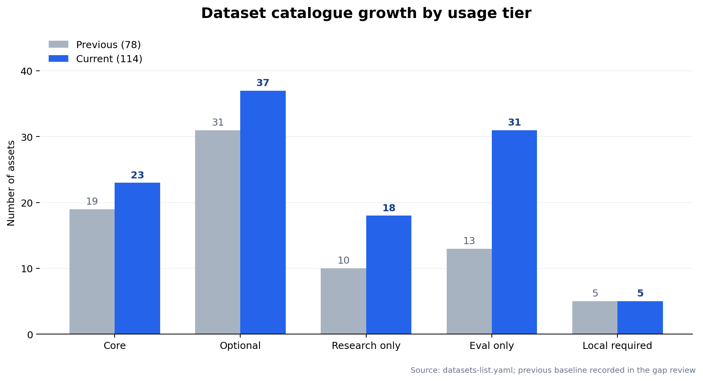

# GitHub awesome-datasets 差分复核与补齐报告

> 本报告解释 `datasets-list.yaml` 的第二轮差分结果。这里的“补齐”指当前文本 Base LLM 后训练配方在能力、阶段、许可治理、评测隔离和本地物料上的阶段性完备，不是永久穷尽所有公开数据集。

## 1. 执行结论

本轮从 GitHub awesome 清单召回候选，再逐项回到官方项目、Hugging Face 元数据或数据卡核验，最终将总表从 **78 项扩展到 114 项**，新增 **36 项**。新增部分包括 **18 项训练／研究资产**和 **18 项 eval_only 资产**；旧 **42 项全部保留**。能力维度由 **23 项扩展到 26 项**，新增 `long_output`、`browser_agent`、`agent_safety`。

这次复核的重点不是数量，而是纠正“论文口径、当前数据卡口径、配置口径、构造样本口径”混用的问题。所有公开评测都设置为 `train_prohibited=true`；同仓库的训练和测试切分也拆成不同资产。许可不清、官方页面不可访问、版本无法固定或属于继续预训练的候选没有为凑数晋升，而是保留在延期或范围外清单。

## 2. 数量与覆盖的真实变化

| usage_tier | 上一版 | 当前 | 变化 |
|---|---:|---:|---:|
| core | 19 | 23 | +4 |
| optional | 31 | 37 | +6 |
| research_only | 10 | 18 | +8 |
| eval_only | 13 | 31 | +18 |
| local_required | 5 | 5 | +0 |
| **合计** | **78** | **114** | **+36** |

| 指标 | 上一版 | 当前 | 说明 |
|---|---:|---:|---|
| 必需能力 | 23 | 26 | 新增长输出、浏览 Agent、Agent 安全 |
| 旧资产保留 | 42/42 | 42/42 | 无旧 ID 丢失 |
| 训练／研究新增 | 0 | 18 | core、optional、research_only 分层 |
| 独立评测新增 | 0 | 18 | 全部 eval_only |

数量增加并不意味着推荐全量混用。`core` 仍只是首轮配方候选，`optional` 需要按消融加入，`research_only` 包含非商用或许可待审数据，`local_required` 则是公共数据无法替代的业务物料。当前结构校验只证明引用、分层和覆盖关系一致，不证明样本质量或许可签署已经完成。

## 3. awesome 来源矩阵与使用方式

awesome 项目只承担召回职责，不能替代官方数据卡。下表保留了本轮主要召回方向及其在总表中的实际用途；同一数据集被多个 awesome 项目重复收录时，只保留一个 canonical ID，并把重复关系写入 `relations` 或风险说明。

| awesome／官方项目 | 召回方向 | 本轮处理 | 链接 |
|---|---|---|---|
| `jianzhnie/awesome-instruction-datasets` | 通用指令、SFT、偏好 | 召回 Dolly、LongForm、OpenMathInstruct-2 等；规模与许可回到官方卡片 | [GitHub](https://github.com/jianzhnie/awesome-instruction-datasets) |
| `mlabonne/llm-datasets` | 通用、指令、偏好、安全 | 用于查漏，不直接采用二手许可或样本数 | [GitHub](https://github.com/mlabonne/llm-datasets) |
| `haolpku/Awesome-LLM-Data-Preparation` | 数据准备、合成、过滤、去污 | 把生成、过滤、验证和谱系纳入训练前门禁 | [GitHub](https://github.com/haolpku/Awesome-LLM-Data-Preparation) |
| `sailxjx/awesome-RLHF` | RLHF、人类偏好、奖励模型 | 补 WebGPT、Summarize-from-Feedback 等经典研究项 | [GitHub](https://github.com/sailxjx/awesome-RLHF) |
| `opendilab/awesome-RLHF` | RLHF、DPO、奖励模型 | 核对 HelpSteer3、Tulu Preference 与 RewardBench 系列 | [GitHub](https://github.com/opendilab/awesome-RLHF) |
| `opendilab/awesome-RLVR` | 数学、代码、通用 RLVR | 补 Nemotron RL、Enigmata；区分 RLVR 与蒸馏 | [GitHub](https://github.com/opendilab/awesome-RLVR) |
| `RenBing-Sumeru/Awesome-LLM-Reasoning-Data` | 推理蒸馏、数学、过程监督 | 补 OpenMathInstruct-2、PathFinder-PRM 与中文 R1 蒸馏 | [GitHub](https://github.com/RenBing-Sumeru/Awesome-LLM-Reasoning-Data) |
| `declare-lab/PathFinder-PRM` | PRM 官方项目 | 400K 三维步级标签；作为 PRM800K 派生项而非独立无风险数据 | [GitHub](https://github.com/declare-lab/PathFinder-PRM) |
| `Lhy723/awesome-ai-agent-evaluation` | 工具、网页、软件工程 Agent | 补 Mind2Web、τ-bench、AgentHarm 等独立评测 | [GitHub](https://github.com/Lhy723/awesome-ai-agent-evaluation) |
| `philschmid/ai-agent-benchmark-compendium` | Agent 工具与环境 | 区分静态轨迹、动态环境、工具调用和任务效用 | [GitHub](https://github.com/philschmid/ai-agent-benchmark-compendium) |
| `EvanThomasLuke/Awesome-AI-Security-Benchmarks` | 越狱、红队、Agent 安全 | 补 HarmBench、StrongREJECT、AgentDojo | [GitHub](https://github.com/EvanThomasLuke/Awesome-AI-Security-Benchmarks) |
| `ant-research/awesome-mllm-guardrails` | 安全、拒答、过拒 | 只吸收文本部分；多模态数据保持范围外 | [GitHub](https://github.com/ant-research/awesome-mllm-guardrails) |
| `AiHubCN/Awesome-Chinese-LLM` | 中文指令、中文推理 | 补中文 R1 蒸馏；上游 NC 与事实性继续复核 | [GitHub](https://github.com/AiHubCN/Awesome-Chinese-LLM) |
| `RUCAIBox/awesome-llm-pretraining` | 预训练与长上下文数据 | 识别 LongABC 属 CPT，不错误纳入后训练长输出 | [GitHub](https://github.com/RUCAIBox/awesome-llm-pretraining) |
| `BenchGecko/awesome-llm-benchmarks` | 通用、推理、代码、长文评测 | 补 Omni-MATH、GPQA、RULER、BigCodeBench、MT-Bench | [GitHub](https://github.com/BenchGecko/awesome-llm-benchmarks) |

## 4. 本轮新增资产

### 4.1 训练与研究资产

这些条目补的是明确结构缺口或高价值经典基线，而不是把 awesome 中出现的所有名字机械合并。人工小集、长输出、精确指令、数学代码、偏好、RLVR、PRM、工具、浏览、中文多语言和安全均有新增；其中 NC 数据已单独隔离，许可待审项也不能因为标为 optional 就绕过门禁。

| ID | 层级 | 当前官方规模口径 | 收录理由 | 来源 |
|---|---|---|---|---|
| `dolly_15k` | core | 15,000 instruction_records | 补可商用人工指令小集与风格基线 | [官方来源](https://huggingface.co/datasets/databricks/databricks-dolly-15k) |
| `longform` | optional | 23,652 train_samples | 补长输出训练，不再以长输入替代长输出 | [官方来源](https://huggingface.co/datasets/akoksal/LongForm) |
| `ifeval_like_filtered` | optional | 56,339 filtered_samples | 补可验证约束 SFT；只用 filtered 配置 | [官方来源](https://huggingface.co/datasets/argilla/ifeval-like-data) |
| `openmathinstruct2` | core | 13,972,791 problem_solution_pairs | 补大规模数学指令与公平降采样消融 | [官方来源](https://huggingface.co/datasets/nvidia/OpenMathInstruct-2) |
| `opencodeinstruct` | core | 5,000,000 instruction_response_pairs | 补 500 万代码指令与执行过滤字段 | [官方来源](https://huggingface.co/datasets/nvidia/OpenCodeInstruct) |
| `codefeedback_filtered` | optional | 156,000 samples_approx | 补高复杂度单轮代码指令 | [官方来源](https://huggingface.co/datasets/m-a-p/CodeFeedback-Filtered-Instruction) |
| `helpsteer3_preference` | core | 40,476 preference_samples | 补多域、多轮、多语言人工偏好 | [官方来源](https://huggingface.co/datasets/nvidia/HelpSteer3) |
| `tulu3_preference_mixture` | research_only | 272,898 preference_pairs | 保留经典偏好配方研究基线，整体非商用隔离 | [官方来源](https://huggingface.co/datasets/allenai/llama-3.1-tulu-3-8b-preference-mixture) |
| `nemotron_cascade_2_rl` | optional | 73,809 config_rows_total | 补 IF、通用、SWE 与 on-policy distillation 配置 | [官方来源](https://huggingface.co/datasets/nvidia/Nemotron-Cascade-2-RL-data) |
| `toolmind` | optional | 360,000 assistant_turn_samples | 补大规模多轮工具轨迹与执行过滤 | [官方来源](https://huggingface.co/datasets/Nanbeige/ToolMind) |
| `enigmata_data` | research_only | 未填固定值；generator_tasks | 补规则可验证逻辑谜题 RLVR | [官方来源](https://huggingface.co/datasets/BytedTsinghua-SIA/Enigmata-Data) |
| `pathfinder_prm` | research_only | 400,000 samples_approx | 补三维步级错误监督 | [官方来源](https://github.com/declare-lab/PathFinder-PRM) |
| `weblinx` | research_only | 未填固定值；chat_turns | 补文本化网页导航研究轨迹 | [官方来源](https://huggingface.co/datasets/McGill-NLP/WebLINX) |
| `falsereject_train` | research_only | 14,624 training_prompts | 补带标准/CoT 响应的防过拒训练 | [官方来源](https://huggingface.co/datasets/AmazonScience/FalseReject) |
| `m2lingual` | research_only | 173,672 dataset_rows | 补多语言多轮指令研究数据 | [官方来源](https://huggingface.co/datasets/ServiceNow-AI/M2Lingual) |
| `chinese_r1_distill_110k` | optional | 110,000 samples | 补中文通用与数学推理蒸馏 | [官方来源](https://huggingface.co/datasets/Congliu/Chinese-DeepSeek-R1-Distill-data-110k) |
| `webgpt_comparisons` | research_only | 19,578 comparisons | 补带引用答案的人类偏好研究 | [官方来源](https://huggingface.co/datasets/openai/webgpt_comparisons) |
| `summarize_from_feedback` | research_only | 未填固定值；comparison_and_axis_rows | 补经典摘要人类偏好研究 | [官方来源](https://huggingface.co/datasets/openai/summarize_from_feedback) |

### 4.2 独立评测资产

新增评测用于闭合训练能力的独立验收，不得转成训练提示、蒸馏输入或偏好对。尤其是 AgentHarm 的 canary、Mind2Web 的测试分发约束、GPQA 的 gated 条款、SORRY-Bench 的第三方转移限制，以及 τ-bench 的版本不可比性，都必须随数据版本一起归档。

| ID | 当前官方规模口径 | 覆盖目的 | 来源 |
|---|---|---|---|
| `longform_test` | 2,045 test_samples | 长输出独立测试 | [官方来源](https://huggingface.co/datasets/akoksal/LongForm) |
| `omni_math` | 4,428 competition_problems | 高难奥林匹克数学评测 | [官方来源](https://huggingface.co/datasets/KbsdJames/Omni-MATH) |
| `gpqa_diamond` | 198 questions | 研究生级科学知识与推理评测 | [官方来源](https://huggingface.co/datasets/Idavidrein/gpqa) |
| `ruler` | 未填固定值；configurable_tasks | 可配置长上下文评测 | [官方来源](https://github.com/NVIDIA/RULER) |
| `bigcodebench` | 1,140 full_tasks | 实用代码生成执行评测 | [官方来源](https://github.com/bigcode-project/bigcodebench) |
| `mgsm` | 250 parallel_problems_per_language | 多语言数学与跨语言母题去污目标 | [官方来源](https://arxiv.org/abs/2210.03057) |
| `mt_bench` | 80 multi_turn_prompts | 通用多轮对话评测 | [官方来源](https://huggingface.co/datasets/HuggingFaceH4/mt_bench_prompts) |
| `rewardbench2` | 1,865 test_samples | 新一代六类奖励模型评测 | [官方来源](https://huggingface.co/datasets/allenai/reward-bench-2) |
| `prmbench` | 未填固定值；step_level_evaluation_samples | 细粒度过程奖励评测 | [官方来源](https://github.com/ssmisya/PRMBench) |
| `harmbench` | 未填固定值；red_teaming_behaviors | 标准化自动红队评测 | [官方来源](https://github.com/centerforaisafety/HarmBench) |
| `strongreject` | 313 forbidden_prompts | 越狱攻击与空攻击基线评测 | [官方来源](https://github.com/dsbowen/strong_reject) |
| `sorry_bench_202503` | 9,240 unsafe_instructions | 细粒度、多变换安全拒答评测 | [官方来源](https://huggingface.co/datasets/sorry-bench/sorry-bench-202503) |
| `agentharm` | 44 public_test_base_behaviors | Agent 有害/良性行为安全评测 | [官方来源](https://huggingface.co/datasets/ai-safety-institute/AgentHarm) |
| `mind2web_test` | 1,341 test_tasks | 跨任务、网站和领域浏览评测 | [官方来源](https://github.com/OSU-NLP-Group/Mind2Web) |
| `agentdojo` | 未填固定值；dynamic_attack_defense_tasks | 动态提示注入攻防评测 | [官方来源](https://github.com/ethz-spylab/agentdojo) |
| `enigmata_eval` | 4,758 puzzle_instances | 逻辑谜题独立评测 | [官方来源](https://huggingface.co/datasets/BytedTsinghua-SIA/Enigmata-Eval) |
| `falsereject_test` | 1,187 human_annotated_prompts | 人工标注防过拒评测 | [官方来源](https://huggingface.co/datasets/AmazonScience/FalseReject) |
| `tau_bench_2_text` | 900 single_trial_calls | 六语言政策约束多轮工具 Agent 评测 | [官方来源](https://github.com/sierra-research/tau2-bench) |

## 5. 官方核验对二手口径的纠正

下表是本轮最容易影响训练配方和合规判断的差异。报告采用“当前官方可固定版本优先”的原则：论文数字可以写入注释用于解释历史口径，但不会覆盖当前数据卡的实际配置和规模；无法直接核实的数字一律保留为 null，而不是用二手估计补齐。

| 数据集 | 二手或易误用口径 | 本版处理 |
|---|---|---|
| OpenCodeInstruct | 二手清单可能写错组织 | 固定为 `nvidia/OpenCodeInstruct`；5,000,000 条，CC-BY-4.0 [官方来源](https://huggingface.co/datasets/nvidia/OpenCodeInstruct) |
| FalseReject | 论文约 15K train／1.1K test | 当前卡片为 14,624 train＋1,187 test；两响应字段不等于两份独立提示 [官方来源](https://huggingface.co/datasets/AmazonScience/FalseReject) |
| M2Lingual | 182K IR pairs／约 175K conversations | 当前 `full_data` 元数据为 173,672 行；行、pair、conversation 不混写 [官方来源](https://huggingface.co/datasets/ServiceNow-AI/M2Lingual) |
| HelpSteer3 | 把所有配置加成一个规模 | 本清单仅 Preference 40,476；Feedback/Edit 等配置分开 [官方来源](https://huggingface.co/datasets/nvidia/HelpSteer3) |
| Nemotron-Cascade-2-RL | 把全包称同质 RLVR | IF-RL、multi-domain-RL、MOPD、SWE-RL 四配置；MOPD 是蒸馏 [官方来源](https://huggingface.co/datasets/nvidia/Nemotron-Cascade-2-RL-data) |
| IFEval-like | 模糊写 100K–1M | default 550,000；filtered 56,339；名称不代表已对 IFEval 去污 [官方来源](https://huggingface.co/datasets/argilla/ifeval-like-data) |
| Tulu 3 Preference | 只看 ODC-BY 推断可商用 | 官方明确部分子集非商用；整包 research_only [官方来源](https://huggingface.co/datasets/allenai/llama-3.1-tulu-3-8b-preference-mixture) |
| Enigmata-Data | 用二手 418K 当固定官方规模 | 生成器规模不猜数；官方卡片 CC-BY-NC-4.0，Eval 另为 Apache-2.0 [官方来源](https://huggingface.co/datasets/BytedTsinghua-SIA/Enigmata-Data) |
| AgentHarm | 把论文 440 augmented 当当前公开下载量 | 当前 public test 44 base／176 augmented；validation 8／32；canary 禁训 [官方来源](https://huggingface.co/datasets/ai-safety-institute/AgentHarm) |
| SORRY-Bench | 用代码 MIT 代替数据许可 | 2025/03 数据为 gated 自定义协议，含禁止第三方转移条款 [官方来源](https://huggingface.co/datasets/sorry-bench/sorry-bench-202503) |
| τ-bench | 继续引用旧 τ-bench 或猜测独立 τ³ 仓库 | 当前官方维护在 `sierra-research/tau2-bench`；本版固定 2.0.0 text-v1 |
| LongAttn / LongABC | 误作长输出 SFT | 官方是长上下文继续预训练，post-training 范围外 |

## 6. 已覆盖、重复与不再重复收录的项

| 类型 | 代表项 | 本版处理 |
|---|---|---|
| 已有通用主集 | Dolci、Tulu 3 SFT、SmolTalk2、OpenHermes、Infinity-Instruct | 保留 canonical 项；大合集不直接相加，继续来源级去重 |
| 已有数学推理 | OpenMathReasoning、NuminaMath、Mixture-of-Thoughts、DAPO、DeepScaleR | 新增 OpenMathInstruct-2 是不同配方与规模补集，仍按 GSM8K/MATH 母题去污 |
| 已有代码推理 | OpenCodeReasoning、TACO、CodeContests、KodCode、Magicoder | OpenCodeInstruct/CodeFeedback 补指令风格；不替代可执行 RLVR 题目库 |
| 已有偏好 | HelpSteer2、HH-RLHF、UltraFeedback、Nectar、Arena、Skywork | HelpSteer3 固定 Preference；Tulu 整包非商用；WebGPT/摘要偏好仅研究 |
| 已有工具 | xLAM、ToolACE、Glaive、ToolBench、API-Bank | ToolMind 按来源去重；τ-bench 公开任务不得经增广回流训练 |
| 已有安全 | Aegis、WildGuardMix、PKU-SafeRLHF、XSTest | FalseReject 补训练，HarmBench/StrongREJECT/SORRY/AgentHarm 补不同评测面 |
| 已有 PRM | PRM800K、Math-Shepherd、ProcessBench | PathFinder 标为 PRM800K 派生；PRMBench 只作评测 |
| 不再重复收录 | awesome 中同一项目的镜像、改名和二手搬运 | 只保留官方 canonical 来源；401 的镜像不作为已核验项 |

重复项的处理依赖内容、母题、网站、仓库、来源和教师谱系，而不是只按名称判断。特别是 Aya/M2Lingual、ToolMind/xLAM/ToolACE、PRM800K/PathFinder、GSM8K/MGSM/中文数学蒸馏之间，即使文本哈希不同，也可能存在同源或翻译泄漏。

## 7. 许可、教师与上游风险

| 风险 | 代表资产 | 必须执行的控制 |
|---|---|---|
| 许可仅看合集标签 | Tulu Preference、Infinity-Instruct、中文 R1 蒸馏、ToolMind | 分别审合集、上游样本、教师输出和访问协议；任一层未过则不进入默认商用配方 |
| 非商用与相同方式共享 | M2Lingual、WebLINX、FalseReject、Enigmata-Data | 统一 research_only；NC/SA 不与商用 core 混合 |
| 教师服务条款 | IFEval-like、LongForm、CodeFeedback、WebGPT、中文 R1 蒸馏 | 记录教师模型、生成日期和条款版本；数据卡许可不自动覆盖教师输出 |
| 母题与跨语言污染 | OpenMathInstruct-2、Numina、PRM800K、中文 R1 蒸馏 | 对 MATH/GSM8K/Omni-MATH/MGSM 做母题、翻译和语义去污，而非只做字符串哈希 |
| 同 repo 切分泄漏 | LongForm、FalseReject、Enigmata、WebLINX | train/test 拆资产；test 一律 eval_only，文件哈希与 split 固定 |
| 静态轨迹误当动态环境 | WebLINX、ToolMind、API-Bank | 文本轨迹用于 SFT；动态网页/工具环境另行回放，分别报告任务效用与安全 |
| 危险内容与用途限制 | SORRY-Bench、AgentHarm、HarmBench、StrongREJECT | 隔离访问、保留 canary、遵守用途和转移限制；只用于安全评测或获批研究 |
| 规模口径膨胀 | HelpSteer3、ToolMind、M2Lingual、Nemotron RL | 分开记录独立提示、行、turn、轨迹、任务、配置和构造偏好对 |

许可判断必须分层：代码许可、数据许可、上游内容许可、模型输出条款、 gated 访问协议和实际产品用途不是同一件事。`allowed_with_obligations` 也只表示官方许可字段相对明确，并不等于已完成法务签署；`review_required` 和 `noncommercial` 不得进入默认商用训练包。

## 8. 三个新能力维度与仍未闭合的缺口

| 新能力 | 当前训练候选 | 当前独立评测 | 已闭合的部分 | 尚未闭合的部分 |
|---|---|---|---|---|
| `long_output` | LongForm | LongForm test＋私有时间外评测 | 长输出不再由长输入数据代替 | 事实一致性、跨章节依赖、多文档冲突、业务长文 |
| `browser_agent` | WebLINX 研究轨迹 | Mind2Web＋私有时间外评测 | 静态轨迹与跨网站评测已有结构入口 | 可商用训练、动态环境、账号安全、在线回放 |
| `agent_safety` | 本地领域安全与政策样本 | AgentHarm＋AgentDojo＋私有评测 | 有害行为、良性行为和提示注入攻防进入矩阵 | 真实工具返回注入、数据外泄、危险动作与业务政策 |

除三个新维度外，中文精确指令、多语言人工偏好和开放式通用推理奖励仍然不足。IFEval-like、M2Lingual 和中文 R1 蒸馏主要是合成数据，不能替代中文人工约束数据与多语言人工偏好；Enigmata 只证明规则谜题可以 RLVR，不代表科学问答、开放写作和通用推理都有可靠自动奖励。

因此，本轮可以把清单称为“阶段性覆盖完整”，不能称为“训练物料已经全部就绪”。真正可执行的训练配方仍需要目标 Base、上下文长度、语言比例、领域分布、算力和商用边界，才能决定子集和配比。

## 9. 延期、范围外与版本替代

| 候选 | 状态 | 原因 |
|---|---|---|
| PRISM Alignment | deferred | 本次官方数据卡访问返回 401，未核验当前字段、许可和规模，不写成已核验推荐项 |
| Skywork-SynPref-40M | deferred | 论文可核实 40M 池与 26M 精选子集，但当前官方 HF API/README 返回 401，固定数据包与许可未核验 |
| Qwen AutoIF | deferred | 官方数据卡本次返回 401；已有 Tulu Persona IF、IFEval-like filtered 与 VerInstruct，不凭二手清单晋升 |
| WebDancer / WebSailor | deferred | 当前未形成可核验的固定训练数据卡与许可；WebLINX 仅补非商用静态轨迹，动态环境仍须专项建设 |
| Mind2Web train | deferred | 官方声明研究用途且测试包单独分发；本版只将 1,341 测试任务列 eval_only，训练侧先用 WebLINX 研究轨迹 |
| SWE-bench-extra | deferred | 本次原始数据卡访问返回 401；已有 SWE-Gym/SWE-smith/R2E-Gym，不为凑数纳入未核验项 |
| LongAttn / LongABC | out_of_scope | 官方项目为长上下文继续预训练数据，不属于本 post-training 清单；不得当作长输出 SFT |
| 多模态数据集 | out_of_scope | 本清单范围限定文本 Base LLM；WebLINX 仅保留文本化聊天轨迹，图像和语音分支不纳入 |
| τ-bench legacy | superseded | 旧任务已过时；本版使用 sierra-research/tau2-bench 的 τ-bench 2.0.0 text-v1，且不与 1.x 分数直接比较 |

延期并不等于永久否决。后续只要官方数据卡恢复、固定 revision 和许可可以核验，并且资产能补真实结构缺口，就可以从候选池晋升；在此之前，自动发现结果只能进入 `pending_review`，不能自动写入 canonical 总表。

## 10. 自动更新与训练前边界

当前维护链路以 `build_datasets_list.py` 为 canonical 生成源，以 `datasets-list.yaml` 为机器总表，再生成人类可读目录；taxonomy 负责自动发现分类，更新脚本负责刷新 Hugging Face 元数据、记录候选和保留历史。定时工作流只自动更新发现与元数据，不自动晋升候选，也不替代人工许可和去污审查。

本轮维护链路已实测：6 项单元测试全部通过；63 个唯一 Hugging Face 仓库刷新成功、0 个失败；执行 5 条发现查询，没有新增候选，累计 11 个候选仍为 `pending_review`。使用同一固定时间连续离线复跑，第二次 `changed_files=[]`，确认生成幂等。

训练 Manifest 在 `--allow-placeholders` 下通过结构与权重校验，但严格模式仍有 9 项发布门禁未闭合：输出目录、Base 模型 ID 与 revision、3 个启用数据集的不可变 revision，以及数据质量、许可、去污签署。这些占位符和签署不能由自动流程伪造，因此当前 Manifest 不是开训凭证。

本轮没有下载全量数据，没有固定所有训练文件的不可变 revision 和哈希，也没有执行样本级事实核验、代码沙箱、工具 Schema 执行、网页动态回放或完整去污。因此，报告结论限于静态官方资料核验、结构覆盖和维护机制验证；训练前仍需完成版本、许可、质量、隐私、安全和评测隔离签署。

| 门禁 | 当前状态 | 训练前动作 |
|---|---|---|
| 官方来源与配置口径 | 本轮已复核 | 固定 revision、文件名、split、config 和哈希 |
| 能力覆盖与 eval_only 隔离 | 结构校验通过 | 在数据加载器中继续强制，不仅依赖文档标记 |
| 自动发现分类 | 6 项测试通过；63/63 刷新成功；固定时间二次复跑零变更 | 新候选只进 pending_review，人工核验后晋升 |
| Manifest 模板结构 | 允许占位符模式通过；严格模式尚有 9 项未闭合 | 填写真实模型、路径和 revision，完成三项签署后再严格校验 |
| 全量样本质量 | 未执行 | 抽样与程序验证结合，记录失败率和过滤规则 |
| 母题／语义／翻译去污 | 未执行 | 对所有公开评测及私有时间外评测统一执行 |
| 许可与教师条款 | 静态初筛 | 按实际产品和商用边界完成正式签署 |
| 动态 Agent 环境 | 未执行 | 固定环境快照、工具 Schema、账号、攻击和回放版本 |
