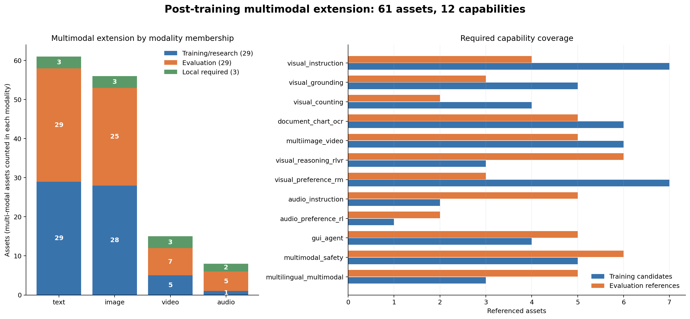

# 多模态 Base 模型后训练数据集调研与物料清单

> 快照：2026-11-09。范围是图像、视频、音频与 GUI Agent 的后训练理解、指令、偏好／奖励、RLVR、安全和独立评测；不纳入媒体生成、raw caption、特征对齐预训练或 mid-training。

## 1. 结论与交付边界

本次在保留原 **114 项文本资产**的基础上新增 **61 项多模态资产、12 项能力**，合并后 canonical 共 **175 项资产、38 项能力**。新增部分包含 **32 项训练／研究／本地物料**和 **29 项 eval_only 独立评测**。

这里的“补齐”是能力与治理覆盖闭合，不是穷尽公开数据，也不代表获得训练或商用授权。现有 `commercial-default-manifest.yaml` 与 `research-isolated-manifest.yaml` 仍是 **ERNIE 文本专用**；多模态 Base、processor、输入契约和硬件未指定前，不生成虚构的多模态启动配方。

官方 HF 批量快照共请求 **48 个候选 repo**：**38 个成功、10 个当前返回 401**。成功项记录了 SHA、lastModified、gated、license、configs、features 和可得行数；失败项只保留官方项目／论文口径，不编造 revision。该比例是元数据可访问率，不是样本内容审计率。

### 新增资产分层

| 指标 | 数量 | 说明 |
|---|---:|---|
| core | 7 | 多模态扩展实际计数 |
| optional | 14 | 多模态扩展实际计数 |
| research_only | 8 | 多模态扩展实际计数 |
| eval_only | 29 | 多模态扩展实际计数 |
| local_required | 3 | 多模态扩展实际计数 |
| modality=text | 61 | 集合计数；多模态资产可重复属于多个模态 |
| modality=image | 56 | 集合计数；多模态资产可重复属于多个模态 |
| modality=video | 15 | 集合计数；多模态资产可重复属于多个模态 |
| modality=audio | 8 | 集合计数；多模态资产可重复属于多个模态 |

## 2. 调研方法与召回入口

调研经过多轮主题检索，先覆盖 MLLM 后训练索引，再分别核查视觉指令、PixMo、视频、文档／OCR、偏好、RLVR、GUI、音频、安全、中文／多语言和独立评测。awesome 清单只用于召回，规模、许可、split 和字段回到官方项目、论文或 Hugging Face 数据卡。

- [Awesome Post-Training for MLLMs](https://github.com/zchoi/Awesome-Post-Training-for-MLLMs)：召回 MLLM SFT、偏好与 RL 方向。
- [awesome-llm-post-training](https://github.com/mbzuai-oryx/awesome-llm-post-training)：交叉检查训练阶段分类。
- [awesome-instruction-dataset](https://github.com/yaodongC/awesome-instruction-dataset)：补指令数据入口，不直接继承二手许可和规模。
- [LLaVA-OneVision-2](https://github.com/EvolvingLMMs-Lab/LLaVA-OneVision-2)：核对新一代图像／视频配方与 22M Instruct、FineVision、长视频数据的关系。
- [AudioBench](https://github.com/AudioLLMs/AudioBench)：核对音频评测是 50+ 任务套件，而不是可随意汇总行数的同质数据集。

完整官方元数据快照见 `research/multimodal-official-cards.json`；紧凑切分与字段摘要见 `research/multimodal-metadata-summary.json`。这些文件只保存元数据和数据卡文本，不下载全量媒体样本。

## 3. 通用图像指令、文档、定位与计数

| ID | 模态 | 阶段／层级 | 规模与口径 | 许可口径 | 来源 |
|---|---|---|---|---|---|
| `llava_instruct_150k` | text, image | sft／research_only | 157,710 instruction_samples；当前 FineVision 同名子集也为 157,710；不得与 558K 特征对齐集混写 | CC-BY-4.0 + GPT-4/upstream-terms | [官方来源](https://huggingface.co/datasets/liuhaotian/LLaVA-Instruct-150K) |
| `llava15_mix665k` | text, image | sft／research_only | 665,000 samples_approx；学术任务与 GPT 生成指令混合；558K 是特征对齐预训练，不属于本资产 | research/noncommercial + mixed-upstream | [官方来源](https://github.com/haotian-liu/LLaVA) |
| `llava_onevision15_instruct_22m` | text, image | sft／optional | 22,000,000 samples_approx；22M 官方口径、124 类；part-* 与完整 config 可能重复，不能对全部 config 行数求和 | Apache-2.0 + mixed-upstream | [官方来源](https://huggingface.co/datasets/mvp-lab/LLaVA-OneVision-1.5-Instruct-Data) |
| `finevision` | text, image | sft／optional | 24,000,000 samples_approx；约 24M；200+ config 含完整集与分片，禁止直接汇总所有 config | no-unified-license-in-card + mixed-upstream | [官方来源](https://huggingface.co/datasets/HuggingFaceM4/FineVision) |
| `pixmo_ask_model_anything` | text, image | sft／core | 161,737 samples；default/train 精确行数；图像通过 URL＋SHA 引用 | ODC-By | [官方来源](https://huggingface.co/datasets/allenai/pixmo-ask-model-anything) |
| `pixmo_points` | text, image | sft／core | 2,376,222 samples；default/train 精确行数；每行可含多个点，行数不等于点数 | ODC-By | [官方来源](https://huggingface.co/datasets/allenai/pixmo-points) |
| `pixmo_point_explanations` | text, image | sft／optional | 79,551 samples；default/train 精确行数；含解析点与文本解释 | ODC-By | [官方来源](https://huggingface.co/datasets/allenai/pixmo-point-explanations) |
| `pixmo_docs` | text, image | sft／core | 251,165 train_samples_total；charts 116,814＋diagrams 16,551＋other 71,282＋tables 46,518；各 config 另有 1,024 validation | ODC-By | [官方来源](https://huggingface.co/datasets/allenai/pixmo-docs) |
| `pixmo_count_train` | text, image | sft／core | 36,916 train_samples；train 36,916；validation/test 各 540，独立资产隔离 | ODC-By | [官方来源](https://huggingface.co/datasets/allenai/pixmo-count) |
| `pixmo_cap_qa` | text, image | sft／optional | 271,714 samples；default/train 精确行数；caption-conditioned QA | ODC-By | [官方来源](https://huggingface.co/datasets/allenai/pixmo-cap-qa) |

关键边界：

1. **LLaVA-Instruct-150K、LLaVA-1.5 Mix665K 和 558K 特征对齐预训练不是同一资产**；最后一项不在本后训练清单。
2. **OneVision 的 part-* 与完整 config 可能重复，FineVision 也含完整集和分片**；不能把全部 config 行数直接求和。Merged46M 必须先做来源与内容去重。
3. **PixMo 的样本行数不等于点、物体或媒体文件数**；图像 URL 可用率、SHA、隐私和上游图像权利是独立门禁。
4. `pixmo_count_train` 与 `pixmo_count_test` 同 repo 但拆资产；test 540 条永远禁止训练。

## 4. 多图、视频与时空理解

| ID | 模态 | 阶段／层级 | 规模与口径 | 许可口径 | 来源 |
|---|---|---|---|---|---|
| `mantis_instruct` | text, image | sft／optional | 721,000 samples_approx；官方论文约 721K、14 个多图核心子集；当前 HF 还含单图补集，分别按 config 计数 | Apache-2.0 + mixed-upstream | [官方来源](https://huggingface.co/datasets/TIGER-Lab/Mantis-Instruct) |
| `llava_video_178k` | text, image, video | sft／optional | 178,000 source_videos；178K 是视频数；论文约 1.6M 指令，caption/open_ended/multi_choice 分开，不写成 178K QA | no-explicit-license-in-card + mixed-video-upstream | [官方来源](https://huggingface.co/datasets/lmms-lab/LLaVA-Video-178K) |
| `videochat_flash_training` | text, image, video | sft／optional | 未填固定值；video_instruction_samples；长上下文视频指令混合包；当前 API 未提供统一切分行数 | Apache-2.0 + mixed-upstream | [官方来源](https://huggingface.co/datasets/OpenGVLab/VideoChat-Flash-Training-Data) |
| `molmo2_videotrack` | text, image, video | sft／optional | 未填固定值；video_track_samples；default/train；当前 API 未提供固定行数 | ODC-By | [官方来源](https://huggingface.co/datasets/allenai/Molmo2-VideoTrack) |
| `molmo2_videopoint` | text, image, video | sft／core | 658,340 train_samples；default/train 精确行数；其他类别 config 不与其直接相加 | ODC-By | [官方来源](https://huggingface.co/datasets/allenai/Molmo2-VideoPoint) |

Mantis 的约 721K 是论文中的 14 个多图核心子集口径，当前 HF 还含单图补集。部分多图样本由单图对话拼接，且与 LLaVA、DocVQA、ChartQA 存在上游重叠。[Mantis 官方项目](https://github.com/TIGER-AI-Lab/Mantis)

LLaVA-Video-178K 的 178K 指视频来源，不是 QA 总量；caption、open-ended、multiple-choice 和时长／来源 config 分开。视频训练记录必须包含媒体哈希、FPS、帧数、时长、是否使用字幕、媒体 token 和 supervised text token。[LLaVA-Video 官方论文](https://arxiv.org/abs/2410.02713)

## 5. 多模态偏好、推理蒸馏与 RLVR

| ID | 模态 | 阶段／层级 | 规模与口径 | 许可口径 | 来源 |
|---|---|---|---|---|---|
| `llava_human_preference_10k` | text, image | preference, reward_model／optional | 未填固定值；human_preference_pairs；名称 10K，公开项目约 9.42K；当前 API 无切分行数 | Apache-2.0 + upstream-terms | [官方来源](https://huggingface.co/datasets/zhiqings/LLaVA-Human-Preference-10K) |
| `rlhf_v` | text, image | preference, reward_model／research_only | 1,400 segment_level_human_corrections_approx；约 1.4K 段级人类修正，不与整句偏好对直接等量混合 | CC-BY-NC-4.0 | [官方来源](https://github.com/rlhf-v/rlhf-v) |
| `rlaif_v` | text, image | preference, reward_model／research_only | 未填固定值；ai_feedback_pairs；开源模型反馈；当前卡片未给切分行数 | CC-BY-NC-4.0 | [官方来源](https://huggingface.co/datasets/openbmb/RLAIF-V-Dataset) |
| `vlfeedback` | text, image | preference, reward_model／optional | 80,258 prompts；default/train 80,258 提示；多模型回答可展开 pair，但 pair 数不等于独立提示数 | no-explicit-license-in-card + GPT-4V/upstream | [官方来源](https://huggingface.co/datasets/MMInstruction/VLFeedback) |
| `povid` | text, image | preference, reward_model／optional | 未填固定值；constructed_preference_pairs；构造负例偏好数据；当前 API 未给切分行数 | CC-BY-4.0 + upstream-terms | [官方来源](https://huggingface.co/datasets/YiyangAiLab/POVID_preference_data_for_VLLMs) |
| `r1_onevision` | text, image | sft, rlvr／optional | 未填固定值；reasoning_samples_and_rl_tasks；自然场景、科学、数学、OCR 和图表；SFT 与 RL 文件／配置必须分别固定 | Apache-2.0 + mixed-upstream | [官方来源](https://huggingface.co/datasets/Fancy-MLLM/R1-Onevision) |
| `visual_rft_tasks` | text, image | rlvr／research_only | 未填固定值；task_specific_rl_configs；分类、检测、grounding 等任务分别使用官方数据与奖励；不是一个无差别全量包 | mixed-see-task-upstream | [官方来源](https://arxiv.org/html/2503.01785v1) |

偏好数据按三类分开：**人类修正／排序、AI 反馈、构造负例**。不得把 pair 展开数当独立提示数，也不得把 chosen 默认成安全答案。VL-RewardBench 当前卡片为 1,247 条，和论文常用的 1,250 口径差异被显式保留。[VL-RewardBench 官方项目](https://vl-rewardbench.github.io/)

RLVR 与推理蒸馏必须分离：长 CoT 文件属于 SFT；在线 RL 需要 prompt、ground truth／环境和任务验证器。Visual-RFT 的分类正确性、检测 IoU、grounding 坐标和格式奖励不能合并为一个“通用正确性”。[Visual-RFT 官方论文](https://arxiv.org/html/2503.01785v1)

## 6. 音频指令、GUI Agent 与安全

| ID | 模态 | 阶段／层级 | 规模与口径 | 许可口径 | 来源 |
|---|---|---|---|---|---|
| `voice_assistant_400k` | text, audio | sft／optional | 470,054 train_samples；当前 default/train 470,054，不是名称中的 400K；question_audio＋文本答案＋answer_snac | Apache-2.0 + GPT-4o/TTS-terms | [官方来源](https://huggingface.co/datasets/gpt-omni/VoiceAssistant-400K) |
| `os_atlas_action_sft` | text, image | agent_sft／core | 未填固定值；gui_action_samples；只登记下游 action SFT；13M GUI elements 属 Base grounding 预训练，不冒充 Agent 轨迹 | Apache-2.0 + upstream-terms | [官方来源](https://huggingface.co/datasets/OS-Copilot/OS-Atlas-Data) |
| `gui_odyssey_train` | text, image | agent_sft／core | 8,834 episodes_total_before_split；全集 8,834 episodes；实际训练量取决于 random/task/device/app 官方 split，不能写为单一训练行数 | CC-BY-4.0 | [官方来源](https://huggingface.co/datasets/hflqf88888/GUIOdyssey) |
| `android_control_train` | text, image | agent_sft／research_only | 未填固定值；gui_action_episodes；High-Level／Low-Level 与训练／测试分开；当前 HF API 401，未登记精确规模 | mixed-see-official-card | [官方来源](https://github.com/google-research/google-research/tree/master/android_control) |
| `vlguard_train` | text, image | sft／optional | 未填固定值；safety_instruction_samples；gated=auto；训练与测试文件、safe/unsafe 子集分别固定 | MIT + gated-and-upstream-terms | [官方来源](https://huggingface.co/datasets/ys-zong/VLGuard) |
| `spa_vl_train` | text, image | preference, reward_model／research_only | 93,258 preference_pairs；train 93,258；validation 7,000、HarmEval 265、HelpEval 265 独立，不相加 | mixed-model-output-and-upstream | [官方来源](https://sqrtizhang.github.io/SPA-VL/) |
| `safe_vid_350k` | text, image, video | preference, reward_model／research_only | 350,000 video_safety_preference_pairs_approx；官方论文约 350K 视频安全偏好对 | CC-BY-NC-SA-4.0 | [官方来源](https://huggingface.co/datasets/yxwang/SafeVid-350K) |
| `local_multimodal_sft` | text, image, video, audio | sft／local_required | 未填固定值；internal_records；由业务方定义媒体规模、时长、切分、脱敏和不可变版本 | INTERNAL | 官方来源 |
| `local_multimodal_preference` | text, image, video, audio | preference, reward_model, rlvr／local_required | 未填固定值；internal_records；由业务方定义媒体规模、时长、切分、脱敏和不可变版本 | INTERNAL | 官方来源 |
| `local_gui_action_safety` | text, image, video | agent_sft, agent_rl, preference, evaluation／local_required | 未填固定值；internal_records；由业务方定义媒体规模、时长、切分、脱敏和不可变版本 | INTERNAL | 官方来源 |

VoiceAssistant 当前公开 train 为 470,054 条，不能沿用名称中的 400K；`answer_snac` 是 codec token，不等于直接提供波形。训练前固定采样率、SNAC 解码器、说话人、文本／音频 loss mask 和输出模态。[Mini-Omni 官方项目](https://github.com/gpt-omni/mini-omni)

GUI 的 13M elements、episode、action step、在线 task 是四种不同单位。OS-Atlas 只登记 action SFT，grounding 预训练不冒充 Agent 轨迹；GUIOdyssey 必须在 random／task／device／app 中选择一种官方切分并配套对应测试。[OS-Atlas](https://osatlas.github.io/), [GUIOdyssey](https://github.com/OpenGVLab/GUI-Odyssey)

安全侧同时评估危险请求攻击成功率、正常请求效用、幻觉和过拒。SPA-VL 的 train／validation／HarmEval／HelpEval 分开；MM-SafetyBench 为 CC BY-NC 4.0，只进研究评测隔离。[SPA-VL](https://sqrtizhang.github.io/SPA-VL/), [MM-SafetyBench](https://github.com/isXinLiu/MM-SafetyBench)

**音频公开人类偏好与可验证 RL 数据仍是缺口。** 本版没有为追求阶段齐全而虚构公共数据，改由 `local_multimodal_preference` 明确本地建设责任，VoiceBench 仅用于独立语音助手评测。

## 7. 独立评测与中文覆盖

所有公共 benchmark 均为 `eval_only`。同 repo 训练／测试拆资产，judge 输出不得反哺训练；图像尺寸、视频抽帧、字幕、音频采样、选项协议和评分器均需固定。

| 领域 | 独立评测 |
|---|---|
| 综合视觉与推理 | [MMMU validation](https://huggingface.co/datasets/MMMU/MMMU), [MMMU-Pro standard 10 options](https://huggingface.co/datasets/MMMU/MMMU_Pro), [MMStar](https://github.com/MMStar-Benchmark/MMStar), [MathVista testmini](https://huggingface.co/datasets/AI4Math/MathVista), [MathVision test](https://huggingface.co/datasets/MathLLMs/MathVision) |
| 文档、图表与 OCR | [DocVQA validation](https://huggingface.co/datasets/lmms-lab/DocVQA), [ChartQA test](https://huggingface.co/datasets/lmms-lab/ChartQA), [OCRBench](https://github.com/Yuliang-Liu/MultimodalOCR) |
| 多图与视频 | [Mantis-Eval](https://huggingface.co/datasets/TIGER-Lab/Mantis-Eval), [Video-MME](https://huggingface.co/datasets/lmms-lab/Video-MME), [MLVU](https://github.com/JUNJIE99/MLVU), [LongVideoBench](https://huggingface.co/datasets/longvideobench/LongVideoBench) |
| 偏好、幻觉与安全 | [VL-RewardBench](https://huggingface.co/datasets/MMInstruction/VL-RewardBench), [MMHal-Bench](https://github.com/open-compass/MMHal-Bench), [MM-SafetyBench](https://github.com/isXinLiu/MM-SafetyBench), [FigStep](https://github.com/ThuCCSLab/FigStep), [SafeVidBench](https://huggingface.co/datasets/yxwang/SafeVid-350K) |
| GUI | [ScreenSpot-v2](https://huggingface.co/datasets/OS-Copilot/ScreenSpot-v2), [GUIOdyssey test splits](https://huggingface.co/datasets/hflqf88888/GUIOdyssey), [OSWorld Verified](https://github.com/xlang-ai/OSWorld), [AndroidWorld](https://github.com/google-research/android_world) |
| 音频 | [VoiceBench](https://huggingface.co/datasets/hlt-lab/voicebench), [MMAU](https://sakshi113.github.io/mmau_homepage/), [AudioBench suite](https://github.com/AudioLLMs/AudioBench), [AIR-Bench](https://huggingface.co/datasets/qyang1021/AIR-Bench-Dataset) |
| 中文／多语言 | [CMMMU test](https://github.com/CMMMU-Benchmark/CMMMU), [CMMU validation / hosted test](https://github.com/FlagOpen/CMMU), [MMBench-CN](https://github.com/open-compass/MMBench), [AudioBench suite](https://github.com/AudioLLMs/AudioBench) |

CMMMU 全集 12,012 题，dev 112、validation 900、test 11,000；本清单只把 test 11,000 作为该资产规模。CMMU 的 validation 与 hosted test 分开，填空题使用规则或 GPT judge 的分数不能直接混比。[CMMMU](https://github.com/CMMMU-Benchmark/CMMMU), [CMMU](https://github.com/FlagOpen/CMMU)

**中文公开 benchmark 不等于中文训练数据。** 当前中文／多语言训练主要依赖 OneVision／FineVision 中经审查的子集和本地真实业务多模态 SFT；公开中文评测不能反向转训练。

## 8. 能力覆盖矩阵

| 能力 | 训练候选数 | 独立评测引用数 | 训练候选 | 独立评测 |
|---|---:|---:|---|---|
| `visual_instruction` | 7 | 4 | `pixmo_ask_model_anything`, `pixmo_cap_qa`, `llava_onevision15_instruct_22m`, `finevision`, `llava_instruct_150k`, `llava15_mix665k`, `local_multimodal_sft` | `mmmu_validation`, `mmstar`, `mmbench_cn`, `local_private_time_eval` |
| `visual_grounding` | 5 | 3 | `pixmo_points`, `pixmo_point_explanations`, `molmo2_videopoint`, `os_atlas_action_sft`, `visual_rft_tasks` | `screenspot_v2`, `pixmo_count_test`, `local_private_time_eval` |
| `visual_counting` | 4 | 2 | `pixmo_count_train`, `pixmo_points`, `molmo2_videopoint`, `llava_onevision15_instruct_22m` | `pixmo_count_test`, `local_private_time_eval` |
| `document_chart_ocr` | 6 | 5 | `pixmo_docs`, `pixmo_cap_qa`, `llava_onevision15_instruct_22m`, `finevision`, `mantis_instruct`, `local_multimodal_sft` | `docvqa_validation`, `chartqa_test`, `ocrbench`, `mathvista_testmini`, `local_private_time_eval` |
| `multiimage_video` | 6 | 5 | `mantis_instruct`, `llava_video_178k`, `videochat_flash_training`, `molmo2_videotrack`, `molmo2_videopoint`, `local_multimodal_sft` | `mantis_eval`, `video_mme`, `mlvu`, `longvideobench`, `local_private_time_eval` |
| `visual_reasoning_rlvr` | 3 | 6 | `r1_onevision`, `visual_rft_tasks`, `llava_onevision15_instruct_22m` | `mmmu_pro_standard10`, `mathvista_testmini`, `mathvision_test`, `chartqa_test`, `cmmmu_test`, `local_private_time_eval` |
| `visual_preference_rm` | 7 | 3 | `llava_human_preference_10k`, `rlhf_v`, `rlaif_v`, `vlfeedback`, `povid`, `spa_vl_train`, `local_multimodal_preference` | `vl_rewardbench`, `mmhal_bench`, `local_private_time_eval` |
| `audio_instruction` | 2 | 5 | `voice_assistant_400k`, `local_multimodal_sft` | `voicebench`, `mmau`, `audiobench`, `air_bench`, `local_private_time_eval` |
| `audio_preference_rl` | 1 | 2 | `local_multimodal_preference` | `voicebench`, `local_private_time_eval` |
| `gui_agent` | 4 | 5 | `os_atlas_action_sft`, `gui_odyssey_train`, `android_control_train`, `local_gui_action_safety` | `screenspot_v2`, `gui_odyssey_test`, `osworld_verified`, `androidworld`, `local_private_time_eval` |
| `multimodal_safety` | 5 | 6 | `vlguard_train`, `spa_vl_train`, `safe_vid_350k`, `local_multimodal_preference`, `local_gui_action_safety` | `mm_safetybench`, `figstep`, `safevidbench`, `voicebench`, `mmhal_bench`, `local_private_time_eval` |
| `multilingual_multimodal` | 3 | 5 | `llava_onevision15_instruct_22m`, `finevision`, `local_multimodal_sft` | `cmmmu_test`, `cmmu`, `mmbench_cn`, `audiobench`, `local_private_time_eval` |

## 9. 延期、范围外与未闭合缺口

| 候选 | 状态 | 原因 |
|---|---|---|
| Audio-FLAN | deferred | 论文召回超 1 亿实例、80 任务且含音频生成；需先固定官方理解子集、许可和生成／理解边界，不整包纳入 |
| AudioBench/MMAU direct HF cards | partially_verified | 官方项目与论文已核验，但当前猜测的 HF repo 返回 401；不登记未经核实的 HF revision 或统一行数 |
| OCRBench/MMStar/BLINK/MLVU direct HF cards | partially_verified | 当前直接 HF API 返回 401；已保留官方项目入口和 eval_only 定义，未编造 SHA 或许可 |
| CMMMU/CMMU direct HF cards | partially_verified | 官方 GitHub 与论文规模已核验，直接 HF API 401；固定发布包后再补 revision |
| GUI-R1 / Video-R1 / VideoChat-R1 | deferred | 代码和奖励流程可召回，但本版未核验统一固定数据包；不把方法仓库当同质数据集 |
| LLaVA 558K / LLaVA-OneVision-1.5-Mid-Training-85M | out_of_scope | 分别是特征对齐预训练和 mid-training，不属于本后训练清单 |
| text-to-image / speech, music and video generation | out_of_scope | 本库覆盖后训练理解、指令、对齐与 Agent，不扩展到媒体生成数据 |
| medical imaging / remote sensing | out_of_scope | 保留为专门领域审查范围；OneVision/FineVision 内相关 config 默认不选 |

仍需训练前闭合的缺口：

1. 大合集逐 config 的上游许可、教师条款、媒体权利和重复谱系尚未全部签署。
2. 当前调研未下载全量媒体、未执行完整样本级质量审核，也未测量 URL 失效率、图像／视频／音频有效时长和 supervised tokens。
3. 多模态 RLVR 验证器、GUI 在线环境、音频 codec 和模型 processor 必须在具体 Base 确定后实际重跑。
4. 中文人工多模态指令、多语言人类偏好、公开音频偏好／RLVR、真实业务 GUI 危险动作和私有时间外评测仍需本地建设。

## 10. 训练前门禁

- [ ] 固定 repo revision、文件哈希和实际 split
- [ ] 按精确/近重复/语义/母题/仓库/网站/媒体内容谱系去重去污
- [ ] 许可、上游媒体、肖像／声音同意、教师服务条款和访问条件分别签署
- [ ] 按有效 token、独立提示、媒体时长、任务和轨迹分别配比
- [ ] 数学/代码/工具/坐标/时空/音频验证器实际重跑
- [ ] 固定图像尺寸、视频抽帧、音频采样率、codec 和 processor
- [ ] eval_only 和私有时间外评测绝不进入训练
- [ ] 多模态配方另行确认 Base 模型、processor、媒体输入契约和硬件；不得复用 ERNIE 文本配方冒充多模态配方。

机器校验：`python validate_datasets_list.py datasets-list.yaml --expect-total 175`。
